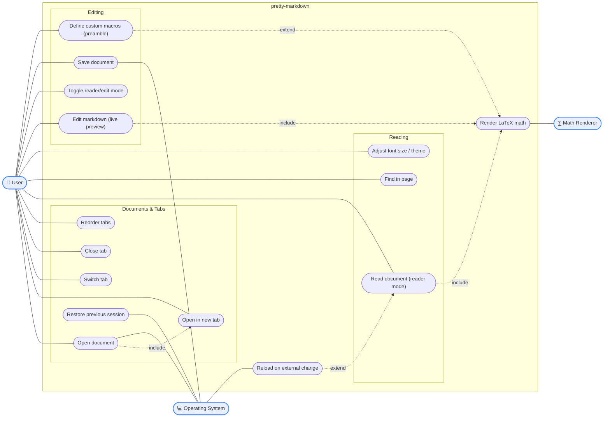

# Use Case Diagram

Actors and what they can do. Modeled as a flowchart (Mermaid has no native use-case type):
stadium-shaped nodes are use cases, `<<include>>`/`<<extend>>` are labeled dotted edges.

